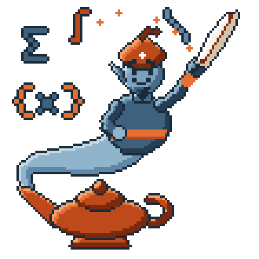
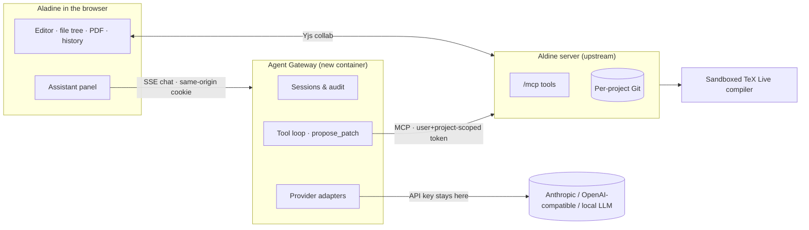

<div align="center">
    

<picture>
<source media="(prefers-color-scheme: dark)" srcset="docs/images/aladine-wordmark-dark.svg">

</picture>

**Collaborative LaTeX with a research-writing assistant built in. It reads your project, compiles it, diagnoses errors, and proposes edits as reviewable diffs that become Git commits only when you approve them.**

[](LICENSE)
[](https://github.com/trahloff/Aldine)
[](docs/AGENT_API.md)
[](agent-gateway/DESIGN.md)
[](agent-gateway/DESIGN.md)
[](docker-compose.yml)
[](PROGRESS.md)

*A fork of [Aldine](https://github.com/trahloff/Aldine), the slim, self-hosted Overleaf alternative.*

</div>

---

> **Development status:** Aladine is in active development. The Aldine editor underneath is usable
> today. The assistant (the Agent Gateway and the assistant panel) is being built in phases,
> tracked in [PROGRESS.md](PROGRESS.md). Interfaces and configuration will change before the first tag.

## What is Aladine?

Aladine is **Aldine with a native research-writing assistant**. Collaborators keep writing and reviewing LaTeX in the browser exactly as before, with real-time multi-cursor editing, Git-native branches, sandboxed ~2 s recompiles and the PDF preview. Any authorized collaborator can also open an assistant panel and chat with an agent that understands the current project.

The assistant runs in a separate **Agent Gateway** service, not inside Aldine's core:

- The browser only talks to the gateway. Provider API keys never reach it.
- The gateway calls the model you configure: Anthropic (default **Claude Haiku 5.5**), any OpenAI-compatible endpoint, or a local model.
- It acts on the project through **Aldine's own MCP server**, using a short-lived credential scoped to that user and that project. Aldine enforces permissions server-side as it does for every other client.

Reading, searching, compiling and diagnosing happen automatically. **Writing does not:** every document change arrives as a structured patch you can **Accept**, **Edit**, or **Reject**. An accepted patch is merged into the live collaborative document, so co-authors see it immediately and nobody's typing is overwritten. It is then committed as **`You (via Paper Assistant)`**, with the session, model, provider and base revision recorded in the commit, where it can be reviewed and reverted from the normal Git history.



## Why "Aladine"?

The name joins **Aldine** and **Aladdin**. Aldine, named after the Aldine Press of Aldus Manutius, the Venetian printer behind italic type and the pocket book, is the editor underneath. Aladdin is the boy with the lamp. This fork puts a genie in Aldine's lamp, with one change to the story: it grants no wish until you have read the diff. The genie can read, search, compile and explain whenever you ask, but it writes nothing you haven't approved, and every wish it grants is recorded in Git.

## Key features

**Everything Aldine already does** (unchanged, see the [upstream README](https://github.com/trahloff/Aldine#features)):

- ✍️ **Real-time collaboration**: Yjs CRDTs, multi-cursor presence, unlimited collaborators
- 🌿 **Git-native projects**: every project is a real repo with branches, history, diffs, merge and revert, plus GitHub/GitLab/Gitea/Forgejo sync
- ⚡ **Fast, sandboxed compiles**: TeX Live + latexmk with ~2 s warm recompiles in a no-egress container, with errors linked to file and line
- 📚 **References**: native Zotero, DOI/arXiv lookup, citation and label indexes
- 🔌 **MCP endpoint** at `/mcp` for external agents such as Claude Code and claude.ai connectors

**What Aladine adds** (✅ done · 🚧 in progress · 🗓️ planned):

| | Feature | |
|---|---|---|
| 🧞 | **Assistant panel**: collapsible, resizable right-hand pane in Aldine's own design language that becomes a drawer on small screens. There is no separate "AI mode". | 🗓️ |
| 💬 | **Streaming chat** with history stored per project and user, with concise tool-progress lines (*Reading related_work.tex… Compiling…*) and raw traces under "Details" | 🗓️ |
| 🎯 | **Context without copy-paste**: open file, cursor, selection, branch, and latest compile status and errors are attached to each message | 🗓️ |
| 🖍️ | **Selection actions**: Explain · Improve wording · Fix LaTeX · Add citation · Ask about selection. Each pre-fills a prompt and never edits directly. | 🗓️ |
| 🧾 | **Reviewable patches**: `propose_patch` returns a diff, and `apply_approved_patch` applies only after you click **Accept**, checked against the revision the agent read | 🗓️ |
| 🪪 | **Git provenance**: commits authored as `You (via Paper Assistant)`, with session, model, provider and base/resulting revision recorded | 🗓️ |
| 🔒 | **Private by default**: chat sessions are visible to their owner unless explicitly shared with the project, and shared sessions are labelled in the list | 🗓️ |
| 🛡️ | **Gateway hygiene**: audit log for every tool call, bounded tool loops, timeouts, cancellation, and keys kept server-side | 🗓️ |
| 🔁 | **Model-agnostic**: provider adapters for Anthropic and OpenAI-compatible APIs, which also cover OpenRouter, vLLM, llama.cpp and Ollama | 🗓️ |

The full product spec is in [ALDINE_AGENT_FORK_SPEC.md](ALDINE_AGENT_FORK_SPEC.md), and the recon findings and gateway design are in [agent-gateway/DESIGN.md](agent-gateway/DESIGN.md).

## Quick start

Today this runs the upstream Aldine stack: the editor plus the sandboxed compiler.

```bash
git clone git@github.com:alejp1998/Aladine.git && cd Aladine
docker compose up -d          # Aldine app on :8080 + no-egress TeX Live compiler
```

Open [localhost:8080](http://localhost:8080). The Agent Gateway compose overlay, with the assistant, MCP and auth already wired, will be documented in [`agent-gateway/README.md`](agent-gateway/README.md) once it lands.

The gateway reads its configuration from environment variables, kept in `agent-gateway/.env`, which is git-ignored:

```env
AGENT_DEFAULT_PROVIDER=anthropic
AGENT_DEFAULT_MODEL=claude-haiku-5-5
ANTHROPIC_API_KEY=...

# Optional: any OpenAI-compatible endpoint (vLLM, llama.cpp, Ollama, OpenRouter)
LOCAL_LLM_BASE_URL=http://vllm:8000/v1
LOCAL_LLM_MODEL=qwen3-instruct
```

### Development

```bash
npm install
npm run dev:server     # Aldine API + collab on :3000
npm run dev:web        # Vite on :5173 (proxies to :3000)
docker build -t aldine-compiler apps/compiler
docker run -d -p 4020:4020 -v $PWD/.data:/data aldine-compiler
```

The Aldine test suites work as upstream: `npm run typecheck -w apps/web`, `npm run test -w apps/web`, and `npm run test:e2e`. [AGENTS.md](AGENTS.md) explains the e2e compiler setup.

## Repository layout

| Path | Purpose |
|------|---------|
| `agent-gateway/` | **New.** Agent Gateway service: auth delegation, sessions, provider adapters, MCP client, patch workflow, audit |
| `apps/server/` | Aldine API, Yjs collab, per-project Git, MCP server (`src/mcp/`). Changes here are small and isolated |
| `apps/web/` | Aldine React SPA. The assistant panel will live in `src/assistant/` |
| `apps/compiler/` | Sandboxed latexmk wrapper (unchanged) |
| `claude-plugin/` | Claude Code plugin and skills for driving Aldine over MCP |
| `docs/` | Aldine docs (`AGENT_API.md`, `OIDC.md`, `SCALING.md`) plus Aladine branding in `docs/images/` |
| `deploy/` | Compose overlays, reverse-proxy samples, cloud stacks |
| `PROGRESS.md` | Running dev log: Done / In progress / Blocked / Next |

## Staying close to upstream

Aladine follows Aldine `main`, which is configured as the `upstream` remote. Collaboration, Git, the compiler and the PDF preview are not forked. New functionality lives in `agent-gateway/` and `apps/web/src/assistant/`. Any change to core code must be small, opt-in, and generic enough to offer upstream, such as attributing MCP writes to a named agent label.

```bash
git fetch upstream && git merge upstream/main
```

## Contributors

- [Alejandro Jarabo-Peñas](https://alejp.me): Aladine fork and Agent Gateway
- [Tobias Rahloff](https://github.com/trahloff) and the [Aldine contributors](https://github.com/trahloff/Aldine/graphs/contributors): the editor underneath

## License

[AGPL-3.0-only](LICENSE), the same as Aldine. If you run a modified Aladine as a network service, you must offer its source to its users.

"Aldine" and the Aldine logo are marks of Tobias Rahloff (see [TRADEMARK.md](TRADEMARK.md)). Aladine is an independent fork, **based on Aldine**, and is not affiliated with or endorsed by the Aldine project. The Aladine icon and wordmark are generated by [`scripts/branding/make_logo.py`](scripts/branding/make_logo.py) in the pixel-art style of the [Lyrebird](https://github.com/SDU-UAS-Center/lyrebird) icon.

Bug reports and feature requests: [GitHub Issues](https://github.com/alejp1998/Aladine/issues).
